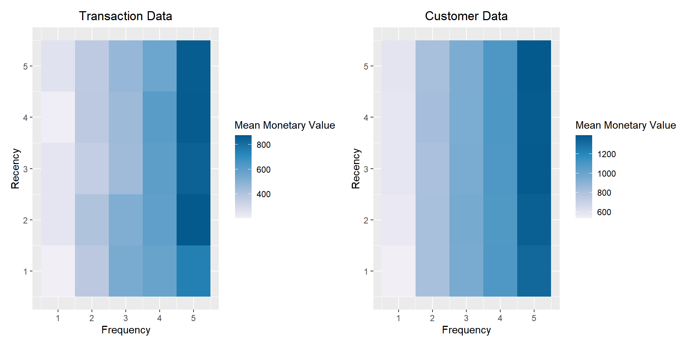

{width="70%"}

We're excited to announce the release of `rfm` 0.2.2 on CRAN! `rfm` provides tools for customer segmentation using **R**ecency **F**requency **M**onetary value analysis. It includes a Shiny app for interactive segmentation. You can install rfm with:

```{r install, eval=FALSE}
install.packages("rfm")
```

::: {.callout-note}
This post describes `rfm` 0.2.2 as released in 2020. Since then the
`rfm_table_*()` family was renamed to `rfm_*_from_data()` (rfm 0.3.0), so the
chunks written against the old API are no longer re-executed. Their outputs
below are preserved from the original 2020 rendering; the pure `dplyr` chunks
still run against the current sample data.
:::

```{r libs, echo=FALSE, message=FALSE, warning=FALSE}
library(rfm)
library(patchwork)
library(dplyr)
```

In this blog post, we will summarize the changes implemented in the current (`0.2.2`) and previous release (`0.2.1`).

## Segmentation

In previous versions, `rfm_segment()` would overwrite a segment if the intervals used to define the segment was a subset of another segment. It was expected that the end user would be careful to ensure that the intervals for each segment would be unique and not a subset of any other segment. You can see the example [here](https://github.com/rsquaredacademy/rfm/issues/67).

We are grateful to <a href="https://github.com/leungi" target="_blank">@leungi</a> for bringing this to our attention and also for fixing it. Now, `rfm_segment()` does not overwrite
the segments even if the intervals for one segment is a subset of another.

```{r segment}
#| eval: false
# analysis date
analysis_date <- lubridate::as_date("2006-12-31")

# rfm score
rfm_result <- rfm_table_order(rfm_data_orders, customer_id, order_date,
                              revenue, analysis_date)

rfm_result

# segmentation
segment_names <- c(
  "Champions", "Loyal Customers", "Potential Loyalist",
  "New Customers", "Promising", "Need Attention", "About To Sleep",
  "At Risk", "Can't Lose Them", "Lost"
)

recency_lower <- c(4, 2, 3, 4, 3, 2, 2, 1, 1, 1)
recency_upper <- c(5, 5, 5, 5, 4, 3, 3, 2, 1, 2)
frequency_lower <- c(4, 3, 1, 1, 1, 2, 1, 2, 4, 1)
frequency_upper <- c(5, 5, 3, 1, 1, 3, 2, 5, 5, 2)
monetary_lower <- c(4, 3, 1, 1, 1, 2, 1, 2, 4, 1)
monetary_upper <- c(5, 5, 3, 1, 1, 3, 2, 5, 5, 2)

segments <-
  rfm_segment(
    rfm_result,
    segment_names,
    recency_lower,
    recency_upper,
    frequency_lower,
    frequency_upper,
    monetary_lower,
    monetary_upper
  )

# segment size
segments %>%
  count(segment) %>%
  arrange(desc(n)) %>%
  rename(Segment = segment, Count = n)
```

Output of `rfm_result`:

```
# A tibble: 995 x 9
   customer_id date_most_recent recency_days transaction_cou~ amount
   <chr>       <date>                  <dbl>            <dbl>  <dbl>
 1 Abbey O'Re~ 2006-06-09                205                6    472
 2 Add Senger  2006-08-13                140                3    340
 3 Aden Lesch~ 2006-06-20                194                4    405
 4 Admiral Se~ 2006-08-21                132                5    448
 5 Agness O'K~ 2006-10-02                 90                9    843
 6 Aileen Bar~ 2006-10-08                 84                9    763
 7 Ailene Her~ 2006-03-25                281                8    699
 8 Aiyanna Br~ 2006-04-29                246                4    157
 9 Ala Schmid~ 2006-01-16                349                3    363
10 Alannah Bo~ 2005-04-21                619                4    196
# ... with 985 more rows, and 4 more variables: recency_score <int>,
#   frequency_score <int>, monetary_score <int>, rfm_score <dbl>
```

Segment sizes:

```
# A tibble: 8 x 2
  Segment            Count
  <chr>              <int>
1 Loyal Customers      278
2 Potential Loyalist   229
3 Champions            158
4 Lost                 111
5 At Risk               86
6 About To Sleep        50
7 Others                48
8 Need Attention       35
```

In the above example, the interval used to define the **Champions** segment is a subset of **Loyal Customers**. In the previous versions, those customers who
should have been assigned **Champions** were reassigned as **Loyal Customers** if the criteria for **Champions** was evaluated before **Loyal Customers**. From version 0.2.0, `rfm_segment()` will avoid such overwriting.

## Visualization

`rfm` used print all the plots by default instead of returning a plot object. This resulted in difficulties for some end users who wanted to:

- further modify the plot
- include the plot in a panel of other plots

From version 0.2.1, all plotting functions use an additional argument `print_plot`. It is set to `TRUE` by default to avoid any disruption to current work flows. Those users who want a plot object to be returned can set the above argument to `FALSE`.

```{r viz, fig.width=10, message=FALSE, warning=FALSE}
#| eval: false
# analysis date
analysis_date <- lubridate::as_date('2007-01-01')

# transactions data
rfm_order <- rfm_table_order(rfm_data_orders, customer_id, order_date,
                             revenue, analysis_date)

# customer data
rfm_customer <- rfm_table_customer(rfm_data_customer, customer_id,
                                   number_of_orders, recency_days, revenue,
                                   analysis_date)

# plots
p1 <-
  rfm_heatmap(rfm_order,
              plot_title = "Transaction Data",
              print_plot = FALSE)

p2 <-
  rfm_heatmap(rfm_customer,
              plot_title = "Customer Data",
              print_plot = FALSE)

# using patchwork
p1 + p2
```



## Custom Threshold for RFM Scores

Lots of users wanted to know the threshold used for generating the RFM scores. From version 0.2.1, `rfm_table_*` family of functions return the threshold.

```{r threshold}
#| eval: false
analysis_date <- lubridate::as_date('2006-12-31')
result <- rfm_table_order(rfm_data_orders, customer_id, order_date,
                          revenue, analysis_date)

# threshold
result$threshold
```

```
# A tibble: 5 x 6
  recency_lower recency_upper frequency_lower frequency_upper monetary_lower
          <dbl>         <dbl>           <dbl>           <dbl>          <dbl>
1            1           115                1               4            12
2          115           181                4               5           256.
3          181           297.               5               6           382
4          297.          482                6               8           506.
5          482           977                8              15           666
# ... with 1 more variable: monetary_upper <dbl>
```

Another request (see [here](https://github.com/rsquaredacademy/rfm/issues/58)) was to be able to use custom or user specific threshold for generating RFM score. `rfm` uses quantiles to generate the lower and upper thresholds used for generating the scores. Unfortunately, if the data is skewed, using quantiles is not effective. From version 0.2.1, users can specify custom threshold for generating the RFM score and we will learn how to do this using an example.

```{r}
#| eval: false
analysis_date <- lubridate::as_date('2006-12-31')
result <- rfm_table_order(rfm_data_orders, customer_id, order_date, revenue,
                          analysis_date)
result$threshold
```

```
# A tibble: 5 x 6
  recency_lower recency_upper frequency_lower frequency_upper monetary_lower
          <dbl>         <dbl>           <dbl>           <dbl>          <dbl>
1            1           115                1               4            12
2          115           181                4               5           256.
3          181           297.               5               6           382
4          297.          482                6               8           506.
5          482           977                8              15           666
# ... with 1 more variable: monetary_upper <dbl>
```

If you look at the above output, we have 5 bins/scores and there are six different values. Let us focus on the `monetary_*` columns in the threshold table. The lower threshold of the first bin and the upper threshold of the last bin are the `min` and `max` values form the `revenue` column of `rfm_data_orders` and the rest of the values are returned by the `quantile()` function.

```{r threshold_min_max}
revenue <-
  rfm_data_orders %>%
  group_by(customer_id) %>%
  summarize(total = sum(revenue))

# revenue at customer level
revenue

# min and max
min(revenue$total)
max(revenue$total)
```

Let us look at the quantiles used for generating the scores.

```{r quantiles}
quantile(revenue$total, probs = seq(0, 1, length.out = 6))
```

The intervals are created in the below style:

`Left-closed, right-open: [ a , b ) = { x ∣ a ≤ x < b } `

Since rfm uses left closed intervals to generate the scores, we add `1` to all values except the minimum value. Now, let us recreate the RFM scores using custom threshold instead of quantiles.

```{r custom_score}
#| eval: false
rfm_table_order(rfm_data_orders,
                customer_id,
                order_date,
                revenue,
                analysis_date,
                recency_bins = c(115, 181, 297, 482),
                frequency_bins = c(4, 5, 6, 8),
                monetary_bins = c(256, 382, 506, 666))
```

```
# A tibble: 995 x 9
   customer_id date_most_recent recency_days transaction_cou~ amount
   <chr>       <date>                  <dbl>            <dbl>  <dbl>
 1 Abbey O'Re~ 2006-06-09                205                6    472
 2 Add Senger  2006-08-13                140                3    340
 3 Aden Lesch~ 2006-06-20                194                4    405
 4 Admiral Se~ 2006-08-21                132                5    448
 5 Agness O'K~ 2006-10-02                 90                9    843
 6 Aileen Bar~ 2006-10-08                 84                9    763
 7 Ailene Her~ 2006-03-25                281                8    699
 8 Aiyanna Br~ 2006-04-29                246                4    157
 9 Ala Schmid~ 2006-01-16                349                3    363
10 Alannah Bo~ 2005-04-21                619                4    196
# ... with 985 more rows, and 4 more variables: recency_score <int>,
#   frequency_score <int>, monetary_score <int>, rfm_score <dbl>
```

We have used the values from the threshold table to reproduce the earlier result. If you observe carefully, we have specified `4` values while generating `5` bins/scores. Whenever using custom threshold, values supplied should be one less than the number of bins/scores generated as `rfm` internally computes the `min` and `max` values. In general, if you have `n` bins/scores, you only specify the upper threshold for `n - 1` bins/scores.

We have tried our best to explain how to use custom threshold but completely understand that it can be confusing to implement at beginning. If you have any questions about this method, feel free to write to us at **support@rsquaredacademy.com** and our team will be happy to help you.

## Acknowledgements

We are grateful to <a href="https://github.com/leungi" target="_blank">@leungi</a>, <a href="https://github.com/gfagherazzi" target="_blank">@gfagherazzi</a> and <a href="https://github.com/DavidGarciaEstaun" target="_blank">@DavidGarciaEstaun</a> for their inputs.

## Learning More

- [Documentation](https://rfm.rsquaredacademy.com)
- [GitHub](https://github.com/rsquaredacademy/rfm)
